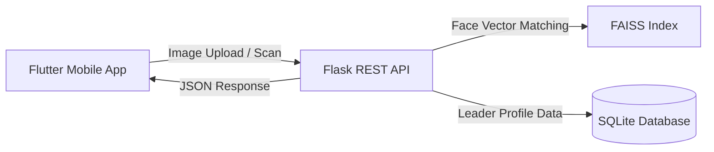

# Smart Voter Project (સ્માર્ટ વોટર પ્રોજેક્ટ)

An AI-powered citizen awareness system that detects and identifies political leaders from election banners, posters, and photos using Computer Vision and Deep Learning, displaying comprehensive report cards (criminal cases, assets, educational qualifications, attendance, and work performance).

---

## 🌟 Key Features
- **Multi-Face Detection & Recognition:** Scans posters with multiple leaders using `face_recognition` (dlib) and FAISS (Facebook AI Similarity Search) index for high-speed matching.
- **Politician Report Card:** Displays detailed profiles including assets, liabilities, criminal records, education, and party affiliation.
- **Side-by-Side Comparison:** Compare any two detected political leaders directly inside the app.
- **Dynamic Server URL:** Configure backend server IP/URL directly from within the Flutter app settings.
- **Production Ready:** Includes Dockerfile, Gunicorn WSGI support, and optimized Android release build.

---

## 🛠️ Architecture & Tech Stack



- **Frontend:** Flutter 3.47+ (Dart)
- **Backend:** Python 3.11 / Flask / Gunicorn
- **Computer Vision:** `face_recognition` (dlib), `faiss-cpu`, OpenCV, PIL
- **Database:** SQLite (`smart_voter_db.sqlite`)
- **Deployment:** Docker / Cloud VM / Local LAN

---

## 🚀 Getting Started

### 1. Backend Setup

```bash
cd backend

# Create and activate virtual environment (optional if using existing)
python -m venv venv
.\venv\Scripts\activate   # Windows
source venv/bin/activate  # Linux/Mac

# Install dependencies
pip install -r requirements.txt

# Run server
python app.py
```
Backend will be available at `http://localhost:5000` (or `http://<YOUR-LOCAL-IP>:5000`).

### 2. Frontend Setup (Flutter)

```bash
cd frontend

# Get Flutter packages
flutter pub get

# Run on connected device / emulator
flutter run

# Or build release APK
flutter build apk --release
```
The release APK is generated at:
`frontend/build/app/outputs/flutter-apk/app-release.apk`

---

## 📁 Project Structure

```
smart_voter_project/
├── backend/
│   ├── app.py                     # Flask API & Face Recognition logic
│   ├── init_db.py                 # SQLite database initializer
│   ├── requirements.txt           # Python dependencies
│   ├── Dockerfile                 # Container deployment
│   ├── smart_voter_db.sqlite      # SQLite database
│   ├── faces_faiss_idmap.index    # FAISS vector index
│   └── known_faces/               # Reference face images
├── frontend/
│   ├── lib/
│   │   ├── main.dart              # Flutter entry point
│   │   ├── models/                # Data models
│   │   ├── screens/               # UI Screens (Home, Result, Detail, Compare)
│   │   └── widgets/               # Custom UI widgets & bounding box painter
│   └── android/                   # Android native configuration
├── .gitignore
└── README.md
```

---

## 📄 License
This project is for educational and civic awareness purposes.
